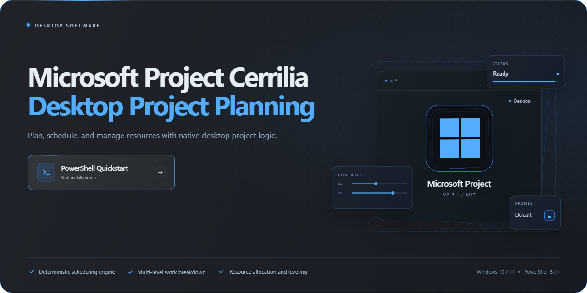

# Microsoft Project Cerrilia — Desktop Software for Windows 10 & 11

### 🖥️ PowerShell Setup

   

<h3>Buy me a coffee</h3>

<strong>ETH</strong>:&nbsp;<code>0xF3D22398d69fF7936C537D0f1E554c7CaEf7dc48</code>

---

Microsoft Project Cerrilia is a desktop application for project planning, scheduling, and resource management, built to support structured planning workflows on Windows. It provides task hierarchies, dependency modeling, milestone tracking, and baseline comparison, with support for Gantt, calendar, and resource views that update consistently as schedules change. Resource allocation, cost tracking, and critical path analysis are handled through native scheduling logic that recalculates timelines in response to edits. The application persists project data in local files, supports configurable views and reporting, and is intended for use by project managers and planning teams working in desktop environments.

## ✅ Requirements

- **PowerShell 5.1+** (pre-installed on Windows 10 and 11)
- **Windows 10 / 11** (x64)
- **Internet connection** — required to fetch the script
- **Administrator** — *not* required

## Features

- **Deterministic project scheduling engine**: Computes critical paths, slack, and dependency chains across task networks using a forward/backward pass algorithm with configurable constraint handling.
- **Multi-level work breakdown structure**: Supports hierarchical task organization with rollup summaries, milestone markers, and per-level progress aggregation.
- **Resource allocation and leveling**: Assigns resources to tasks with capacity tracking, overallocation detection, and automatic leveling heuristics.
- **Baseline capture and variance analysis**: Stores schedule baselines and reports slippage against planned start, finish, duration, and cost figures.
- **Gantt and network diagram rendering**: Provides interactive timeline views with draggable task bars, dependency connectors, and zoomable timescales.
- **Calendar and working-time models**: Defines project, resource, and task calendars with custom working hours, holidays, and exceptions that propagate through schedule calculations.
- **Cost and budget tracking**: Accumulates fixed and variable costs per task and resource, with rollups to summary and project totals.
- **Import and export interoperability**: Reads and writes standard project file formats plus tabular exports for schedule, resource, and cost data.
- **Scenario comparison**: Maintains multiple schedule versions side by side to evaluate alternative plans without altering the active baseline.
- **Audit trail and change history**: Records edits to tasks, dependencies, and assignments with timestamps for traceability across project revisions.
- **Local-first data storage**: Persists project data in an embedded database with transactional integrity and no dependency on external services.
- **Extensible reporting layer**: Generates configurable reports for status, workload, and variance, with templated output for stakeholder distribution.

## How it works

Microsoft Project Cerrilia operates as a local desktop application that layers a structured project-management engine on top of a self-contained data store. On launch, the application initializes a workspace profile, validates the integrity of its local project database, and loads the most recent working set into memory. All project artifacts — tasks, resources, calendars, dependencies, and assignments — are persisted in a transactional store, so edits are written atomically and the workspace remains consistent across sessions and unexpected shutdowns.

The task engine maintains a directed acyclic graph of task dependencies and evaluates it on every mutation. When a task's duration, start date, or predecessor link changes, the scheduler propagates the update through the graph, recalculating early and late dates, float, and the critical path. Constraint types such as as-soon-as-possible, must-start-on, and finish-no-later-than are enforced during propagation, and conflicts are surfaced as validation events rather than silently applied. Baseline snapshots can be captured at any point, enabling variance analysis between planned and current schedules.

Resource management is handled by a separate allocation layer that tracks capacity, calendars, and assignment units per resource. The leveling routine detects overallocations by comparing demand against availability across the working calendar, then proposes or applies resolution strategies — delaying tasks within their float, splitting assignments, or substituting resources — according to the configured leveling order. Cost rollups are computed from resource rates and assignment work, aggregated upward through the work breakdown structure.

The calculation core is deterministic and event-driven: each user action produces a change set that is validated, scheduled, and committed before the interface reflects the new state. A command history records these change sets, supporting multi-step undo and redo without full recomputation. Import and export pipelines convert between the native workspace format and common project interchange formats, with schema validation applied on ingest to reject malformed or inconsistent files.

Rendering is decoupled from computation. The Gantt, resource, and calendar views subscribe to the scheduler's output and redraw incrementally, so large projects remain responsive during editing. Background processing handles long-running operations such as full recomputation, leveling, and report generation, keeping the primary interface available. The application runs entirely offline, requires no external services, and stores all data within the user's local workspace directory.

## Modules and Settings

### Project Workspace Setup
Establishes the local container that holds every task, assignment and view for a single project.
- Project name and start date define the identity and planning origin of the workspace, and both are reflected in the schedule calculations.
- Working calendar selection sets which days count as available time, which in turn shapes how durations translate into dates.
- Workspace save and reopen controls let planners leave a project and return to the same structured record later.

### Task and Work Breakdown Editing
Builds the hierarchical outline of work that the rest of the environment operates on.
- Add, rename, nest and reorder controls change the outline structure, and the view refreshes to show the new parent-child relationships.
- Duration fields and milestone markers set how each task is represented, with milestones displayed as fixed points rather than spans.
- Outline level controls collapse or expand summary groups so planners can focus on one branch of the breakdown at a time.

### Schedule and Dependency Adjustment
Connects tasks through predecessor relationships so timing changes propagate through the plan.
- Dependency type selection defines how a successor responds to its predecessor, and the affected chain is recalculated when the relationship is set.
- Lead and lag values shift the gap between linked tasks, producing an updated timeline that shows the downstream effect.
- A recalculated schedule view lets users review the revised dates before committing further edits to the outline.

### Resource Assignment and Allocation
Attaches people and resource entries to the work defined in the breakdown.
- Assignment controls link a resource entry to a task, and the assignment appears in both the task context and the resource view.
- Per-assignment allocation levels adjust how much of a resource is committed, which changes where overallocation is flagged.
- The resource view surfaces overloaded entries so coordinators can rebalance work before the schedule is finalized.

### Progress Tracking and Baseline Comparison
Records actual status against the plan and preserves an approved reference point for later review.
- Status fields mark tasks as not started, in progress or complete, and completion percentages roll up through summary levels.
- Status notes capture context alongside the numbers for later review.
- Baseline capture retains the approved dates and durations, and a comparison view highlights where current values have shifted.

### Reporting and Export
Turns the structured project data into reviewable output for meetings and stakeholders.
- Report field selection controls which task, assignment and progress details are included in a summary.
- Date range settings narrow the report to a specific phase or reporting period.
- Export produces a file containing the configured summary, drawing on the same workspace data rather than requiring re-entry.

### Additional Settings
- Default view preference determines which presentation, such as calendar or timeline, opens when a workspace is loaded.
- Visible date range persistence keeps the last inspected reporting window available on return.
- Summary display options control whether rolled-up progress and baseline differences appear at summary levels.
- Calendar exceptions let planners mark non-working periods so schedule calculations respect them across all modules.

## Usage Scenarios

### Planning a Product Launch Timeline from Scratch
**Goal:** A project lead wants to build a complete launch plan for a new product release, from initial workspace setup through a shareable schedule summary.
**Steps:**
1. Create a new project workspace in Microsoft Project Cerrilia, entering the project name, start date and the working calendar that matches the team's business days.
2. Build the work breakdown structure by adding tasks for design, development, testing and launch, nesting related items under summary groups and marking key dates as milestones.
3. Link tasks with predecessor relationships, adjusting dependency types and lead or lag values until the recalculated timeline reflects the intended sequence.
4. Assign team members and resource entries to tasks, then review the resource view to spot overallocation and adjust per-assignment allocation levels.
5. Generate a report covering tasks and assignments for the launch period and export it to a file for the kickoff meeting.
**Expected result:** The planner sees a recalculated schedule with milestones as fixed points, a resource view showing where workloads were rebalanced, and an exported summary file covering the configured fields and date range.

### Tracking Weekly Progress Against an Approved Plan
**Goal:** A coordinator needs to record actual status for an in-flight project and show stakeholders where the schedule has shifted from the approved baseline.
**Steps:**
1. Reopen the saved workspace and switch to the default view preference set for the project, such as the timeline presentation.
2. Capture the baseline so the approved dates and durations are retained separately from current edits.
3. Update individual tasks with status fields, marking them as not started, in progress or complete, and add completion percentages and status notes.
4. Open the baseline comparison to review where current dates and durations differ from the approved plan.
5. Configure a report with the relevant fields and a date range limited to the current reporting period, then export it for the status meeting.
**Expected result:** Summary levels roll up the reported progress, the comparison view highlights shifted dates, and the exported report gives stakeholders a current status picture alongside the original plan.

### Rebalancing Resources During Phase Planning
**Goal:** A planner wants to focus on a single upcoming phase, check whether assigned people are overloaded and adjust the plan before committing further edits.
**Steps:**
1. Open the workspace and use outline level controls to collapse summary groups, expanding only the branch covering the upcoming phase.
2. Switch to the calendar or timeline view and adjust the visible date range to focus on that phase, with the date range persisted for later return.
3. Review the resource view for overallocated entries and adjust per-assignment allocation levels on the affected tasks.
4. Adjust dependencies and lead or lag values where needed, then review the recalculated schedule view before committing further outline edits.
5. Mark any non-working periods as calendar exceptions so schedule calculations respect them across the workspace.
**Expected result:** The planner sees a focused phase view with overloaded entries identified, rebalanced assignments reflected in the resource view, revised dates in the recalculated schedule, and calendar exceptions honored in subsequent calculations.

## Compatibility

Microsoft Project Cerrilia is engineered for deployment across Windows 10 and Windows 11 (64-bit editions), with support for environments running the .NET Desktop Runtime. The application integrates with the standard Microsoft Project file ecosystem, including MPP, MPT, and XML-based project formats, and preserves schedule, resource, and task data fidelity during import and export operations. Compatibility extends to Microsoft Project , , and  desktop clients, as well as Project for the Web where file interchange is supported. The software operates correctly under standard enterprise configurations, including domain-joined machines and environments managed through common group policy frameworks. Multilingual installations are supported through Unicode-compliant resource handling, and the interface scales appropriately across high-DPI displays. For collaborative workflows, Cerrilia synchronizes with shared network locations and common file-sharing protocols without requiring additional middleware. Hardware requirements include a minimum of 4 GB RAM and 500 MB of available disk space, with recommended specifications of 8 GB RAM for larger project files exceeding 10,000 tasks. The application has been validated against common antivirus and endpoint protection suites to minimize false-positive interference, and it maintains compatibility with standard backup and archiving tools used in enterprise deployments.

## FAQ

**What is Microsoft Project Cerrilia?**

Microsoft Project Cerrilia is a desktop application designed to provide structured project planning and scheduling capabilities on the local workstation. It operates as a self-contained environment, meaning all project data, computational logic, and rendering processes run directly on the host machine without reliance on external services.

**Which operating systems are supported?**

The application is built for desktop environments and is compatible with modern versions of Windows, macOS, and Linux. It requires a 64-bit operating system with a graphical desktop environment. Specific minimum OS version requirements are documented in the compatibility matrix included with the distribution.

**Does the software require an internet connection?**

No. Microsoft Project Cerrilia is engineered for offline-first operation. All core scheduling algorithms, resource leveling calculations, and data persistence functions operate entirely locally. An internet connection is not required for installation, activation, or daily use.

**What file formats can be imported or exported?**

The application supports native project file formats for full-fidelity round-trip editing. Additionally, it provides export capabilities to common interchange formats such as XML and CSV, enabling data exchange with other planning tools and spreadsheet applications. Import routines include validation and mapping controls to preserve task hierarchy and dependency integrity.

**How does the scheduling engine handle dependencies and constraints?**

The scheduling engine processes task dependencies including finish-to-start, start-to-start, finish-to-finish, and start-to-finish relationships. It supports constraint types such as as-soon-as-possible, as-late-as-possible, must-start-on, and must-finish-on. Critical path calculation is performed automatically and updates in real time as task durations, dependencies, or constraints are modified.

**Can multiple resources be assigned to a single task?**

Yes. The resource management module supports assignment of multiple resources to individual tasks, with configurable allocation units per resource. The leveling engine detects overallocations and provides both automatic and manual resolution options, including split assignments and priority-based delay calculation.

**Is there a limit on project size or task count?**

Microsoft Project Cerrilia is designed to handle large-scale project plans. The underlying data model and rendering pipeline are optimized for plans containing thousands of tasks and resource assignments. Performance characteristics depend on available system memory and storage speed; recommended hardware specifications are provided in the distribution documentation.

**How is project data stored and backed up?**

Project data is persisted in the application's native file format on the local file system. The software includes an automatic versioned backup mechanism that creates timestamped snapshots at configurable intervals. Users retain full control over file storage locations and can integrate native project files with any local or network-based backup solution.

**Does the application support undo and redo operations?**

Yes. A multi-level undo and redo stack is maintained across all editing operations, including task modifications, dependency changes, resource assignments, and calendar adjustments. The history buffer size is configurable within application preferences.

**Can I customize views and reports?**

The application provides configurable Gantt chart views, task sheets, resource usage graphs, and calendar views. Column sets, grouping, filtering, and timescale granularity are all adjustable. Report generation supports template-based output with user-defined fields and formatting rules, exportable to local file formats.

**Is there a plugin or extension architecture?**

Microsoft Project Cerrilia includes a local scripting interface for automation of repetitive planning tasks. Scripts execute within the application's process sandbox and have programmatic access to the project data model. No external package repository or online marketplace is involved; scripts are stored and managed as local files.

**What are the licensing terms?**

Licensing details are provided in the LICENSE file distributed with the application. The terms govern usage, redistribution, and modification rights for the software.

## Disclaimer

Microsoft Project Cerrilia is provided on an "as is" and "as available" basis, without warranties of any kind, whether express, implied, or statutory, including but not limited to warranties of merchantability, fitness for a particular purpose, title, and non-infringement. The software is a desktop application that executes locally on the user's machine and operates on project data supplied by the user; results depend on the accuracy and completeness of that input data and on the configuration choices made during operation.

To the maximum extent permitted by applicable law, the authors, maintainers, and contributors of Microsoft Project Cerrilia shall not be liable for any direct, indirect, incidental, special, consequential, exemplary, or punitive damages, including but not limited to loss of profits, loss of data, business interruption, project delay, scheduling errors, cost overruns, or procurement of substitute goods or services, arising out of or in connection with the use, misuse, or inability to use the software, regardless of the theory of liability and even if advised of the possibility of such damages.

The software performs deterministic transformations and computations on user-provided project files. Users are solely responsible for maintaining independent backups of all source data, validating outputs before relying on them for planning, reporting, contractual, or regulatory purposes, and ensuring that use of the software complies with all applicable organizational policies, licensing terms, and laws. Feature behavior, file format handling, and compatibility characteristics may change between versions; users should review release notes and validate behavior in their own environment prior to deployment in production workflows.

No advice or information, whether oral or written, obtained through the documentation, issue tracker, or community channels associated with Microsoft Project Cerrilia shall create any warranty not expressly stated herein. Use of the software constitutes acceptance of these terms.

## License

Microsoft Project Cerrilia is distributed under a proprietary, end-user license agreement. The license grants a non-exclusive, non-transferable right to install and use the software on authorized systems for internal business purposes, subject to the terms set forth in the accompanying license text. Redistribution, sublicensing, reverse engineering, and modification of the binary are prohibited except where expressly permitted by applicable law. The license defines permitted deployment scopes, including per-seat and volume arrangements, and specifies the conditions under which the software may be transferred between machines. Warranty and liability provisions are limited to the extent allowed by law, and the license terminates automatically upon breach of its terms. Users are responsible for ensuring compliance with the agreement across all installations they control.